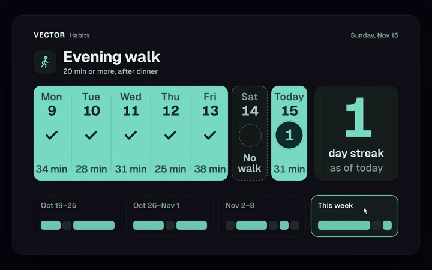

# Habit Week

**A streak tag rides the chain of walks. On a missed day it falls through.**



**Live demo:** [veraetogrex-portfolio.github.io/habit-week](https://veraetogrex-portfolio.github.io/habit-week/) · **Mockup:** [full-screen version](https://veraetogrex-portfolio.github.io/habit-week/mockup/habit-week.html)

A habit tracker for one habit, one week at a time. Walked days fill in left to right and join into one chain, and a round tag with the streak count rides at its head: 1, 2, 3, 4, 5. When the chain reaches a day with no walk, the tag steps onto the empty day, greys out and drops out of the week. The next walk starts a new tag at 1. The card on the right shows the same number, large.

## Use it

Three files, no build step, no dependencies, no web fonts:

```
index.html   markup
style.css    styles
script.js    data, streak logic and animation
```

Download the repo and open `index.html`, or copy the three files into your project.

## Try it

- The page opens on Oct 19–25. Click **This week**: Mon–Fri fill in, the tag counts to 5, falls on Saturday, and Today starts again at 1.
- Click any of the four weeks, or focus the week picker and use ← →. A week you've already seen comes in whole, without counting again.
- Click a day (or focus it and press Enter or Space) to mark or unmark the walk. The chain, the tag and the streak recount at once: mark Saturday on This week and the streak becomes 7.
- A Monday walk continues last week's streak: on Oct 26–Nov 1 the chain comes in from the left edge.
- With reduced motion turned on, every change shows the result straight away.

## Make it yours

At the top of `script.js`:

- `GOAL`: minutes that count as a walk (20). Days under it show "No walk" or their minutes until you mark them.
- `FIRST` and `LOG`: the day before the first week, then minutes walked each day; 0 means no walk. The last entry is today.
- `WEEKS`: how many weeks the picker shows.
- `DRAIN`, `FILL`, `STEP`, `ROLL` and `PAUSE`, `HOP`, `SIT`, `FALL`: timings in ms for the chain growing and the tag falling.

Colours live in `:root` in `style.css`: `--walk` for walked days, `--walk-ink` for the tag and text on them, `--path` for empty days, `--miss` for the dashed edge of a missed day.

## What's in `mockup/`

The full 1440×900 screen this component was shot in for the reel:

- `mockup/habit-week.html` — interactive. `D` plays the demo, `R` resets.
- `mockup/habit-week.autoplay.html` — the scripted loop the reel was recorded from.
- URL flags: `?frame` puts the screen in a browser window, `?clean` hides the control panel, `?once` plays the demo once.

The mockup loads the same `style.css` and `script.js` from the root, plus a shared stage runtime and bundled fonts from `mockup/_shared/`. The component in the root doesn't need any of it.

---

Component 30 of a series. New one every day on Instagram [@veraetogrex_portfolio](https://www.instagram.com/veraetogrex_portfolio/) · all components: [github.com/veraetogrex-portfolio](https://github.com/veraetogrex-portfolio)

MIT licensed.
